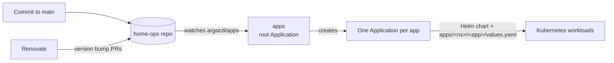

# Architecture

This page is the overview. Each layer has its own page with the details, so facts are only written
once. For the bootstrap steps, see the [Setup Guide](setup.md).

## Layers

| Layer            | Summary                                                              | Details                                |
|------------------|----------------------------------------------------------------------|----------------------------------------|
| Nodes and OS     | 8 Talos Linux machines, configured with `topf`                       | [Hardware](hardware.md), [Cluster Overview](cluster.md) |
| Networking       | Cilium, Envoy Gateway, Cloudflare Tunnel, external-dns               | [Networking](networking.md)            |
| Storage          | Rook-Ceph block (RBD) and OpenEBS hostpath                           | [Storage](storage.md)                  |
| Databases        | CloudNativePG PostgreSQL clusters                                    | [Databases](databases.md)              |
| Backups          | Kopiur, CNPG Barman Cloud, etcd snapshots, NAS snapshots and B2       | [Backups](backups.md)                  |
| Secrets          | Infisical through External Secrets, SOPS for files in Git           | [Secrets Management](secrets.md)       |
| Security         | Kyverno (audit mode), Istio ambient, Falco, Authentik SSO               | [Security](security.md)                |
| Observability    | OpenTelemetry collectors into Mimir, Loki, Tempo and Grafana         | [Observability](observability.md)      |
| Delivery         | ArgoCD reconciles this repository, Renovate opens update PRs         | This page (below)                      |

## GitOps Flow

ArgoCD runs inside the cluster and reconciles it against this repository. Nothing is deployed by
hand after bootstrap.



- The `apps` root Application points at `argocd/apps` and recurses through it. Each file there is an
  ArgoCD `Application`.
- Most applications use **multi-source** Applications: the Helm chart comes from its upstream
  registry, and the values file comes from this repository via a `$repo` reference.
- Automated sync is on with `prune` and `selfHeal`, so removing a manifest removes the resource and
  manual drift is reverted.
- Renovate opens PRs for chart and image updates. Merging a PR is the deployment.

### Repository Conventions

```text
apps/<namespace>/<app>/      Helm values, kustomization and ExternalSecrets for one app
argocd/apps/<namespace>/     ArgoCD Application for each app (picked up by the root app)
```

To add an application, create its values under `apps/`, add an `Application` under `argocd/apps/`,
then commit. See `apps/README.md` in the repository for the full checklist.

## Checks

GitHub Actions runs prek (pre-commit hooks), schema validation, a dead Helm values scan and the docs build on
every pull request.
