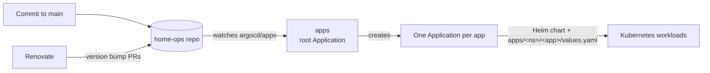
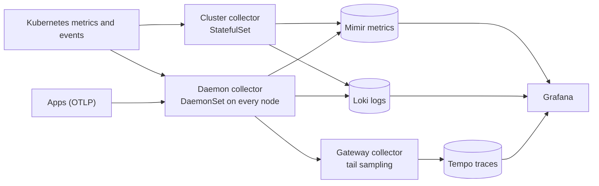

# Architecture

This page explains how the pieces of the homelab fit together. For the step-by-step bootstrap, see the
[Setup Guide](setup.md).

## Overview

| Layer          | Technology                                                       |
|----------------|------------------------------------------------------------------|
| Operating system | [Talos Linux](https://www.talos.dev/), immutable and API-driven |
| Orchestration  | Kubernetes, configured per node with [topf](https://github.com/postfinance/topf) |
| GitOps         | [ArgoCD](https://argo-cd.readthedocs.io/), watching this repository |
| Networking     | Cilium (CNI), Envoy Gateway (Gateway API), Cloudflare Tunnel     |
| Secrets        | External Secrets Operator, synced from [Infisical](https://infisical.com) |
| Storage        | Rook-Ceph (block, shared filesystem) and OpenEBS                 |
| Backups        | VolSync and Kopiur (Kopia), CloudNativePG with Barman Cloud, etcd snapshots |
| Observability  | OpenTelemetry collectors feeding Mimir, Loki, Tempo and Grafana  |
| Automation     | Renovate for dependency updates, GitHub Actions for checks       |

## Cluster Nodes

The cluster runs on 8 machines: three control-plane nodes and five workers. The control-plane
nodes share the virtual IP `10.0.60.10`, which is the Kubernetes API endpoint.

Talos is the only OS on the nodes. There is no SSH access; configuration changes go through
`talosctl`-compatible machine configs generated by `topf` from `talos/topf.yaml` and
`talos/patches/`. Secrets in the machine config are stored encrypted with SOPS.

## GitOps Flow

ArgoCD runs inside the cluster and reconciles it against this repository. Nothing is deployed by
hand after bootstrap.



- The `apps` root Application points at `argocd/apps` and recurses through it. Each file there is an
  ArgoCD `Application`.
- Most applications use **multi-source** Applications: the Helm chart comes from its upstream
  registry, and the values file comes from this repository via a `$repo` reference.
- Automated sync is on with `prune` and `selfHeal`, so removing a manifest removes the resource and
  manual drift is reverted.
- Renovate opens PRs for chart and image updates. Merging a PR is the deployment.

### Repository Conventions

```text
apps/<namespace>/<app>/      Helm values, kustomization and ExternalSecrets for one app
argocd/apps/<namespace>/     ArgoCD Application for each app (picked up by the root app)
```

To add an application, create its values under `apps/`, add an `Application` under `argocd/apps/`,
then commit. See `apps/README.md` in the repository for the full checklist.

## Networking

- **Cilium** is the CNI and handles pod networking and network policy.
- **Envoy Gateway** provides the Kubernetes Gateway API. Two gateways live in the `network`
  namespace:
    - `envoy-external` serves services reachable from the internet.
    - `envoy-internal` serves services reachable only from the LAN.
- **Cloudflare Tunnel** exposes `envoy-external` without opening inbound ports on the router.
- **DNS** records are managed automatically: external-dns writes public records to Cloudflare and
  internal records to Pi-hole.
- **cert-manager** issues TLS certificates for the gateways.

Applications publish themselves by adding an `HTTPRoute` that attaches to one of the gateways.

## Secrets

Secrets never live in Git in plain text.

1. Application secrets are stored in **Infisical**.
2. **External Secrets Operator** reads them through a `ClusterSecretStore` and writes Kubernetes
   `Secret` objects.
3. The only secret applied by hand is the Universal Auth credential that lets External Secrets
   reach Infisical. See the [Setup Guide](setup.md).
4. Talos machine secrets are encrypted in the repository with **SOPS** and an age key kept
   offline.

## Storage

- **Rook-Ceph** provides replicated block storage (RBD) and a shared filesystem for workloads that
  need them. Its CRDs use the Ceph CSI driver.
- **OpenEBS** is also installed for node-local volumes.
- **CloudNativePG** runs PostgreSQL clusters. Its backups are shipped to S3-compatible object storage
  through the Barman Cloud plugin.

## Backups

| What                           | Tool                         | Destination            |
|--------------------------------|------------------------------|------------------------|
| Persistent volumes             | VolSync and Kopiur (Kopia)   | Kopia repository, S3   |
| PostgreSQL databases           | CloudNativePG + Barman Cloud | S3-compatible storage  |
| etcd (control plane state)     | Talos backup CronJob         | S3-compatible storage  |

Offsite copies go to Backblaze B2.

## Observability

Telemetry is collected by the OpenTelemetry Operator and stored in three backends. Grafana queries
all of them.



- Alert rules in Mimir send notifications to Discord.
- Applications send traces head-sampled. The gateway collector then keeps errors and requests slower
  than 500 ms.

## Automation and Checks

- **Renovate** keeps Helm charts, container images and Talos/Kubernetes versions current.
- **GitHub Actions** runs pre-commit checks (YAML validity, yamllint), schema validation and a dead
  Helm values scan on every pull request.
