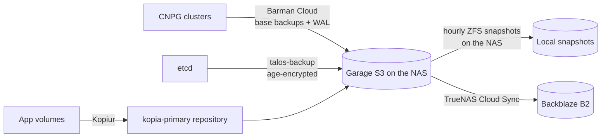

# Backups

Backups run at four layers. Each layer protects a different kind of data.

| What                          | Tool                                | Destination                          |
|-------------------------------|-------------------------------------|--------------------------------------|
| Persistent volumes            | Kopiur (Kopia)                      | Kopia repository in S3 (Garage)      |
| PostgreSQL databases          | CloudNativePG + Barman Cloud plugin | S3 (Garage), base backups and WAL    |
| etcd (control plane state)    | talos-backup CronJob                | S3 (Garage), age-encrypted           |
| NAS datasets                  | TrueNAS ZFS snapshots, hourly       | Local to the NAS (not offsite)       |
| Offsite copy                  | TrueNAS Cloud Sync                  | Backblaze B2                         |

The S3 endpoint is Garage on the LAN (`10.0.60.15`, on the NAS). It has three buckets: `kopia` for volume
snapshots, `etcd-backup` for etcd snapshots, and `cnpg` for database backups. Credentials for each backup come from ExternalSecrets (see
[Secrets](secrets.md)).

## Volume Backups: Kopiur

[Kopiur](https://kopiur.home-operations.com) is a Kubernetes operator that drives Kopia, a deduplicating,
encrypted backup tool.

- The cluster-wide `ClusterRepository` `kopia-primary` stores all snapshots in a Garage bucket named
  `kopia`. Encryption uses a password from a Secret.
- Only the namespaces listed in the repository's `allowedNamespaces` can use it. This keeps a single
  repository without giving every namespace access.
- A Kopia server runs in `kopiur-system` for the Kopia UI. The Kopia UI is enabled.
- Each protected volume has a `SnapshotPolicy` and a `SnapshotSchedule`. Schedules keep 7 daily snapshots.

Some volumes still use VolSync-style PVC definitions while they are migrated to Kopiur.

Volumes on NFS storage are not Kopiur-managed. The NAS protects them with its own snapshots and offsite sync. Block volumes that hold configuration or secrets should always have a Kopiur policy.

## Database Backups: CloudNativePG

Every CNPG database has:

- An `ObjectStore` (Barman Cloud) pointing at its own S3 path.
- A `ScheduledBackup` for base backups. Schedules run daily at 02:00. The object store keeps base backups for 30 days
  (`retentionPolicy: 30d`).
- Continuous WAL archiving to the same object store, so a database can be restored to a point in time.

See [Databases](databases.md) for how clusters are configured.

## Control Plane Backups: etcd

A Talos-backed CronJob (`apps/kube-system/etcd-backup/`) takes etcd snapshots through the Talos API every six hours, at minute 10. It
uses a Talos ServiceAccount with the `os:etcd:backup` role. Each snapshot is encrypted with an age key
before upload. The bucket is `etcd-backup` on the same Garage endpoint.

## Restores

- **Volume**: restore through the Kopiur resource for the app, then let ArgoCD resync the workload.
- **Database**: create a new CNPG cluster bootstrapped from the Barman object store, with the target
  recovery time (see the CNPG docs for `bootstrap.recovery`).
- **etcd**: follow the Talos etcd disaster-recovery procedure, using the decrypted snapshot.

Test restores before you need them. A backup that has never been restored is an assumption.

## Offsite

The NAS hosts Garage, and two mechanisms protect its datasets:

- **ZFS snapshots** are taken hourly on TrueNAS. They are stored on the NAS only, so they protect against
  accidental deletion and bad writes, not against losing the NAS.
- **Cloud Sync** runs on TrueNAS and pushes data to Backblaze B2. This is the only copy that survives
  losing the site.

Test restores from both before you need them.

## Failure History

A CiliumNetworkPolicy gap blocked backup traffic for an extended period. Backup jobs can fail silently, so
check the Kopiur, CNPG and etcd backup status after any network change.
