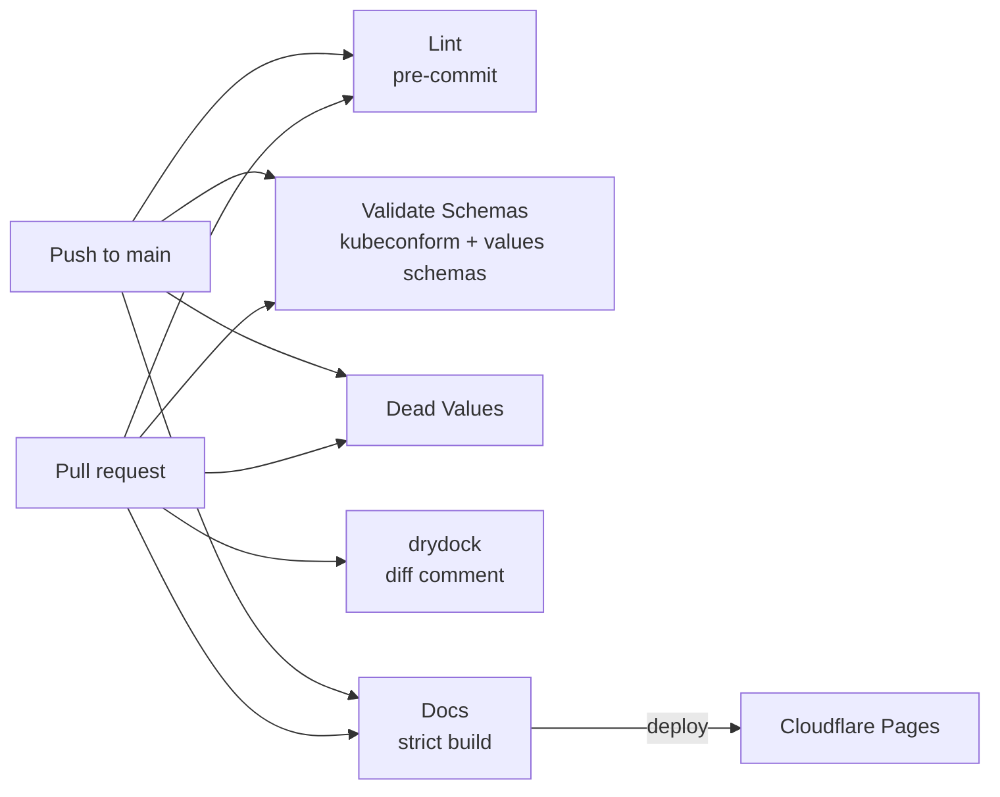

# CI Checks

Checks run in GitHub Actions. Most run on every pull request and again on pushes to `main`. Workflows
live in `.github/workflows/`. Read a failing check before merging.

## What Runs

| Workflow | Runs on | What it checks |
|----------|---------|----------------|
| **Lint** | PRs and pushes to `main` | Runs every pre-commit hook (below) on the whole repository |
| **Validate Schemas** | PRs and pushes to `main` | Kubernetes manifests under `apps/`, and Helm values against their schemas |
| **Dead Values** | PRs and pushes to `main` | Helm values that the chart does not read, and breaking changes to them |
| **drydock** | PRs only | Posts a diff of rendered manifests to the PR, so a reviewer sees the effect of the change |
| **Docs** | PRs and pushes that touch docs | Strict Zensical build; pushes to `main` also deploy the site |



## Pre-commit Hooks

Lint runs the hooks in `.pre-commit-config.yaml`. Run them locally before pushing:

```bash
pre-commit run --all-files
```

| Hook | Purpose |
|------|---------|
| `trailing-whitespace` | Strips trailing spaces |
| `end-of-file-fixer` | Ensures each file ends with one newline |
| `check-yaml` | Checks YAML syntax, allowing multiple documents and custom tags |
| `check-added-large-files` | Blocks accidentally committed large files |
| `check-merge-conflict` | Blocks leftover conflict markers |
| `yamllint` | Applies the repository's `.yamllint.yaml` rules |

`check-yaml` runs with `--unsafe` so Authentik blueprint tags (such as `!Env`) pass. It still catches
real syntax errors.

## Schema Validation

The **kubeconform** job validates every Kubernetes manifest in `apps/` that is not a `values.yaml`. It
runs at the Kubernetes version in the Talos config, and resolves schemas from:

1. kubeconform's built-in set,
2. `.github/schemas/` in the repository,
3. `kubernetes-schemas.pages.dev`,
4. the datreeio CRDs catalog.

Missing schemas are ignored rather than failing the job, so a new CRD without a published schema won't
block a PR. Validation still fails on any schema it does find.

The **helm-values** job reads the `yaml-language-server: $schema=` comment at the top of each
`values.yaml` and validates the file against it. A file without that comment is skipped.

## Dead Values

The **Dead Values** job uses [deadvalues](https://github.com/guarnz/deadvalues) to compare each Helm
values file with its chart. It fails on two things:

- **Dead** keys: values the chart never reads, usually left behind after a chart upgrade or a removed
  feature.
- **Breaking** changes to how values map onto the chart (`fail-on-diff: breaking`).

Dead keys are easy to miss because Helm accepts them silently. Read the
[Helm omitted-key gotcha](#helm-omitted-key-gotcha) below before you delete one to disable a feature.

## Helm Omitted-key Gotcha

Deleting a key from a values file doesn't always disable the feature. If the chart has its own non-empty
default for that key, Helm falls back to it. To turn something off, set the key explicitly to the empty or
disabled value.

## Renovate and Versions

Several workflows pin tool versions with `# renovate:` comments, so Renovate can open update PRs for them,
just like chart and image versions. Actions are pinned to full commit SHAs.

## Docs Workflow

The **Docs** workflow runs `zensical build --strict` on every change to the docs. Strict mode fails the
build on any warning, such as a broken internal link. Pushes to `main` then publish the site to Cloudflare
Pages. Pull requests never deploy. Deploys need the `CLOUDFLARE_API_TOKEN` and `CLOUDFLARE_ACCOUNT_ID`
repository secrets.
