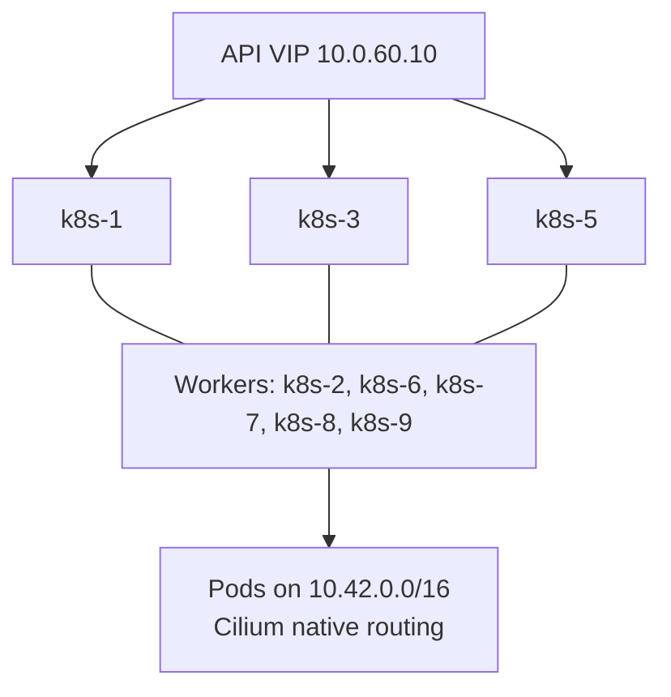
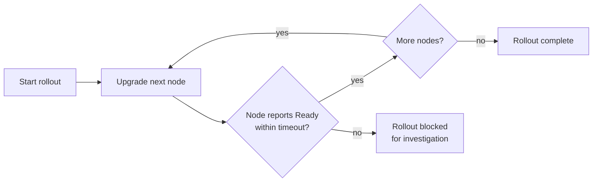

# Cluster Overview

Key facts about the Kubernetes cluster itself. Application-level details live in their own sections of
these docs.

## Versions

| Component             | Version / source                                  |
|-----------------------|---------------------------------------------------|
| Talos Linux           | `v1.14.6` (`talos/topf.yaml`)                     |
| Kubernetes            | `v1.37.2` (`talos/topf.yaml`)                     |
| Cilium (CNI)          | `1.20.5`                                          |
| ArgoCD                | Helm chart, see `argocd/apps/argocd/`             |
| CoreDNS               | `1.50.8`                                          |

Versions are tracked by Renovate. The Talos and Kubernetes versions are also declared as targets for
the upgrade controller (see [Upgrades](#upgrades)).

## Control Plane

- Kubernetes API endpoint: `https://10.0.60.10:6443`, a Talos layer-2 virtual IP shared by the three
  control-plane nodes.
- Control-plane nodes: `k8s-1`, `k8s-3`, `k8s-5`.
- Worker nodes: `k8s-2`, `k8s-6`, `k8s-7`, `k8s-8`, `k8s-9`.
- Pod network: `10.42.0.0/16`, using native routing (no overlay).
- Cilium runs in kube-proxy replacement mode. Pods reach the API server through KubePrism on
  `127.0.0.1:7445`, so they don't depend on the VIP.

## Upgrades

Upgrades are automated by [tuppr](https://github.com/home-operations/tuppr), which applies two custom
resources:

- `TalosUpgrade` sets the target Talos version and rolls it out one node at a time.
- `KubernetesUpgrade` sets the target Kubernetes version.

Both wait for every node to report `Ready` before moving on, so a node that doesn't come back blocks
the rollout instead of letting it continue.

To upgrade, bump the version in `talos/topf.yaml` (Renovate does this automatically) and then update
the matching `TalosUpgrade` or `KubernetesUpgrade` resource in `apps/system-upgrade/tuppr/`.

## Cluster Add-ons

These run in `kube-system` and support everything else:

| Add-on              | Purpose                                                      |
|---------------------|--------------------------------------------------------------|
| Cilium              | CNI, kube-proxy replacement, L2 announcements, Gateway API   |
| CoreDNS             | Cluster DNS                                                  |
| Spegel              | Peer-to-peer container image mirror between nodes            |
| metrics-server      | Resource metrics for `kubectl top` and autoscaling           |
| KEDA                | Event-driven autoscaling                                     |
| Descheduler         | Rebalances pods that have drifted onto unbalanced nodes      |
| Reloader            | Restarts workloads when their ConfigMaps or Secrets change   |
| snapshot-controller | Volume snapshots for CSI drivers                             |
| etcd-backup         | Scheduled, encrypted etcd snapshots to S3 (see [Backups](backups.md)) |
| etcd-defrag         | Periodic etcd defragmentation                                |

## Cluster-wide Policy

Kyverno enforces cluster policy at admission. See [Security](security.md) for the list of policies.

## Where Things Live

| Question                                  | Where to look                             |
|-------------------------------------------|-------------------------------------------|
| How is a node configured?                 | `talos/topf.yaml`, `talos/patches/`       |
| Which chart and version does an app run?  | `argocd/apps/<namespace>/<app>.yaml`      |
| What values does an app run with?         | `apps/<namespace>/<app>/values.yaml`      |
| Which secrets does it read?               | `external-secret.yaml` in the app folder  |
