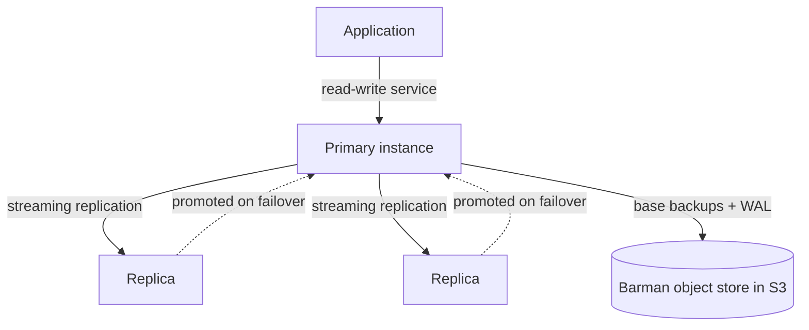

# Databases

PostgreSQL runs through the [CloudNativePG](https://cloudnative-pg.io) (CNPG) operator. Each application that
needs PostgreSQL gets its own CNPG `Cluster` in its own namespace folder.

## Components

| Component                  | Version | Purpose                                                  |
|----------------------------|---------|----------------------------------------------------------|
| CloudNativePG operator     | 0.29.2  | Manages PostgreSQL clusters, failover and upgrades        |
| Barman Cloud plugin        | 0.9.0   | Backups and WAL archiving to S3                          |
| Dragonfly operator         | v1.8.0  | Redis-compatible in-memory store, for apps that need one |

The operators live in the `database` namespace. Their configuration is in `apps/database/`.

## PostgreSQL Clusters

Every CNPG cluster follows the same pattern:

- **3 instances**: one primary and two replicas, spread across nodes.
- **Storage**: `openebs-hostpath` volumes.
- **Backups**: a Barman `ObjectStore` per database, plus a daily `ScheduledBackup`. See [Backups](backups.md).
- **Credentials**: generated and stored through ExternalSecrets (see [Secrets](secrets.md)).

Each database is declared alongside the application that owns it, using the same cluster and backup
template. Storage sizes are set per cluster, typically 10 to 20 Gi per instance.

## Why Local Storage

CNPG replicates data itself, so the database volumes do not need Ceph replication. Using node-local
`openebs-hostpath` keeps write latency low. If a node is lost, a replica on another node takes over,
and the lost instance is rebuilt from the primary.

## Failover and Upgrades

- CNPG promotes a replica automatically if the primary fails.
- Operator and PostgreSQL upgrades are handled by CNPG rolling updates. Avoid changing the instance count
  while a rollout is in progress.

## Monitoring

Each cluster exposes metrics through a `PodMonitor`. Replication lag, connections, disk usage and last
successful backup age are all shown in the CNPG Grafana dashboard. A backup-age alert is the first signal
that a database has stopped being backed up.

## Common Tasks

- Check status: `kubectl cnpg status <cluster> -n <namespace>` (the `cnpg` plugin is in the Nix shell).
- Connect to a primary: `kubectl cnpg psql <cluster> -n <namespace>`.
- Take an ad-hoc backup: create a `Backup` resource for the cluster.
