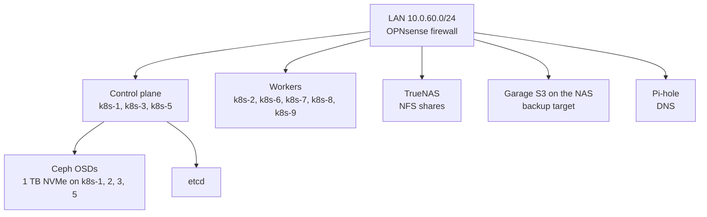

# Hardware

## Cluster Nodes

The cluster runs on eight machines on the `10.0.60.0/24` network. Each node is configured by Talos
from a per-node definition in `talos/topf.yaml`.

### Specs

Values below were read from each node's Talos API (`talosctl get systeminformation`, `processors`,
`memorymodules`, `disks`).

| Node  | Role          | IP           | Model                    | CPU                             | RAM                  | NVMe                              | Other disks       |
|-------|---------------|--------------|--------------------------|---------------------------------|----------------------|-----------------------------------|-------------------|
| k8s-1 | control plane | 10.0.60.21   | HP EliteDesk 800 G5 DM   | Intel i5-9500T, 6C/6T, 2.2 GHz  | 16 GB DDR4-2400     | 256 GB + 1 TB WD Green SN3000    | none              |
| k8s-2 | worker        | 10.0.60.22   | HP EliteDesk 800 G5 DM   | Intel i5-9500T, 6C/6T, 2.2 GHz  | 16 GB DDR4-2400     | 256 GB + 1 TB WD Green SN3000    | none              |
| k8s-3 | control plane | 10.0.60.23   | HP EliteDesk 800 G5 DM   | Intel i5-9500T, 6C/6T, 2.2 GHz  | 16 GB DDR4-2400     | 256 GB + 1 TB WD Green SN3000    | none              |
| k8s-5 | control plane | 10.0.60.25   | HP EliteDesk 800 G5 DM   | Intel i5-9500T, 6C/6T, 2.2 GHz  | 16 GB DDR4-2400     | 256 GB + 1 TB WD Green SN3000    | none              |
| k8s-6 | worker        | 10.0.60.26   | Lenovo ThinkCentre M910q | Intel i5-6500T, 4C/4T, 2.5 GHz  | 16 GB DDR4-3200     | 256 GB                           | 500 GB SATA (WDC) |
| k8s-7 | worker        | 10.0.60.27   | Lenovo ThinkCentre M910q | Intel i5-6500T, 4C/4T, 2.5 GHz  | 16 GB DDR4-2667     | 256 GB                           | 500 GB SATA (WDC) |
| k8s-8 | worker        | 10.0.60.28   | Lenovo ThinkCentre M910q | Intel i5-6500T, 4C/4T, 2.5 GHz  | 16 GB DDR4-2667     | 256 GB                           | 500 GB SATA (WDC) |
| k8s-9 | worker        | 10.0.60.29   | Lenovo ThinkCentre M910q | Intel i5-6500T, 4C/4T, 2.5 GHz  | 16 GB DDR4-2400     | 256 GB                           | 500 GB SATA (WDC) |

Cluster totals: 40 CPU threads, 128 GB RAM, 4 TB of Ceph NVMe (four 1 TB drives), about 2 TB of
256 GB boot NVMe across the eight nodes, and 2 TB of SATA on the Lenovo nodes.

The four HP nodes are the only ones with the 1 TB drives. Ceph OSDs run on `k8s-1`, `k8s-2`, `k8s-3`
and `k8s-5`. The Ceph monitors run on `k8s-3`, `k8s-6` and `k8s-7`.

### Networking and Install

Each node's NIC is selected by MAC address and given a static IP, so a node keeps its identity across
reinstalls. The Talos install disk is set per node in `talos/topf.yaml`:

- `/dev/nvme1n1`: `k8s-1`, `k8s-2`, `k8s-3`, `k8s-5`, `k8s-7`.
- `/dev/nvme0n1`: `k8s-6`, `k8s-8`, `k8s-9`.



## Node Image

Talos images are built from a schematic (`talos/schematic.yaml`) that adds the following system
extensions:

- `siderolabs/i915`: Intel GPU driver.
- `siderolabs/intel-ucode`: Intel CPU microcode.
- `siderolabs/mei`: Intel Management Engine interface.

## Node Configuration

Talos machine configs are rendered by [topf](https://github.com/postfinance/topf) from `talos/topf.yaml`
plus the templates in `talos/patches/`:

- `01-network.yaml.tpl` sets per-node link and VIP configuration.
- `02-install.yaml.tpl` sets the install disk.
- `machine-sysctls.yaml` holds kernel tuning.

Machine secrets are stored SOPS-encrypted in `talos/talsecret.sops.yaml`.

Workflow for config changes:

```bash
cd talos
topf render            # inspect output (gitignored, contains plaintext secrets)
topf apply --dry-run   # show what would change on live nodes
topf apply             # apply
```

## Storage Media

- Ceph OSDs use the 1 TB WD Green SN3000 NVMe drives, selected by a device path filter. Other disks are
  left alone. See [Storage](storage.md).
- Local hostpath volumes live under `/var/mnt/local-hostpath` on each node.

## Off-cluster Hardware

These run outside the cluster:

- **NAS (TrueNAS)**: NFS shares for applications that need them, and the host for Garage. It runs hourly
  hourly ZFS snapshots and a TrueNAS Cloud Sync job to Backblaze B2 (see [Backups](backups.md#offsite)).
- **Garage**: S3-compatible object storage used for backups. It is served from the NAS at `10.0.60.15`.
- **OPNsense**: Firewall and routing.
- **Pi-hole**: Network DNS, also managed by external-dns.
