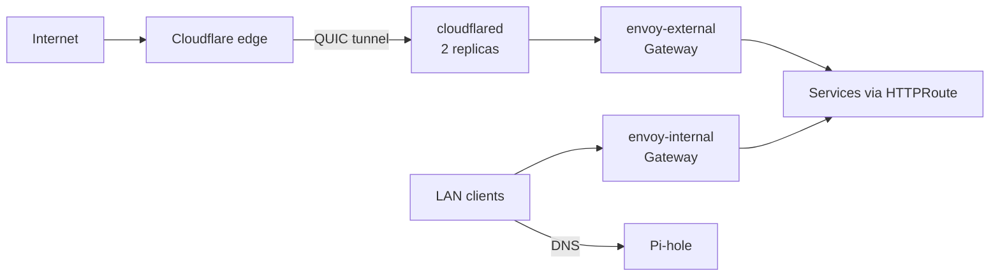

# Networking

## Overview

## Pod Networking: Cilium

- Cilium is the CNI, using native routing with the pod CIDR `10.42.0.0/16`.
- It replaces kube-proxy, so Service routing is handled by eBPF.
- The Gateway API controller is enabled in Cilium, and Cilium also handles L2 announcements.
- Hubble is installed but disabled.

## Gateway API: Envoy Gateway

Envoy Gateway implements the Kubernetes Gateway API. Its `GatewayClass` is `envoy`, and it runs two
replicas. Two shared gateways are defined in the `network` namespace:

| Gateway          | Reachable from       | How traffic gets in                       |
|------------------|----------------------|-------------------------------------------|
| `envoy-external` | Internet             | Cloudflare Tunnel to `external.darkflame.dev` |
| `envoy-internal` | LAN only             | Direct to the gateway's LAN address        |

To publish an app, create an `HTTPRoute` that references one of these gateways and a hostname under
`darkflame.dev`. Attach it to the `https` listener.

Envoy's telemetry is sent to the daemon OpenTelemetry collector, with tracing sampled at 100% at the
edge (the gateway collector then tail-samples; see [Observability](observability.md)).

## Public Access: Cloudflare Tunnel

- `cloudflared` runs as a Deployment with two replicas, spread across nodes by pod anti-affinity.
- It uses QUIC with post-quantum key exchange enabled. Two replicas keep the tunnel up if one node's
  UDP path degrades.
- Tunnel credentials come from an ExternalSecret (see [Secrets](secrets.md)).
- No inbound ports are opened on the router.

## DNS

Two external-dns instances keep records up to date:

- **cloudflare-dns**: Public records in Cloudflare. Targets the Cloudflare Tunnel hostname for
  `external.darkflame.dev`.
- **pihole-dns**: Internal records in Pi-hole, so LAN clients resolve services to `envoy-internal`.

Records are created from `HTTPRoute` and `Gateway` annotations. Manual `DNSEndpoint` objects are used
only for fixed records such as the tunnel CNAME.

## Certificates

- cert-manager issues certificates with Let's Encrypt, through the `letsencrypt-production`
  `ClusterIssuer`.
- A wildcard certificate covers `darkflame.dev` and `*.darkflame.dev`. It is stored in the
  `darkflame-dev-production-tls` secret and used by the gateways.

## Cluster DNS

CoreDNS serves in-cluster names. Its upstream forwarders are configured in `apps/kube-system/coredns/`.

## Network Policy

Cilium network policies are only used in a few places. Six apps ship a `ciliumnetworkpolicy.yaml` next to
their values (agentgateway, falco-k8saudit, fluent-bit, forgejo-runner, gatus, authentik), and the cluster
has one CiliumClusterwideNetworkPolicy (`allow-ambient-hostprobes`). There is no default-deny policy in most
namespaces, so east-west traffic is open except where Istio ambient authorization policies apply. A gap in
these policies caused a past outage, so check the backup and app traffic path after any network change.
A default-deny rollout has not been done yet.

## Off-cluster Network

- **OPNsense** firewalls and routes the `10.0.60.0/24` network.
- **Pi-hole** serves network-wide DNS for LAN clients.
