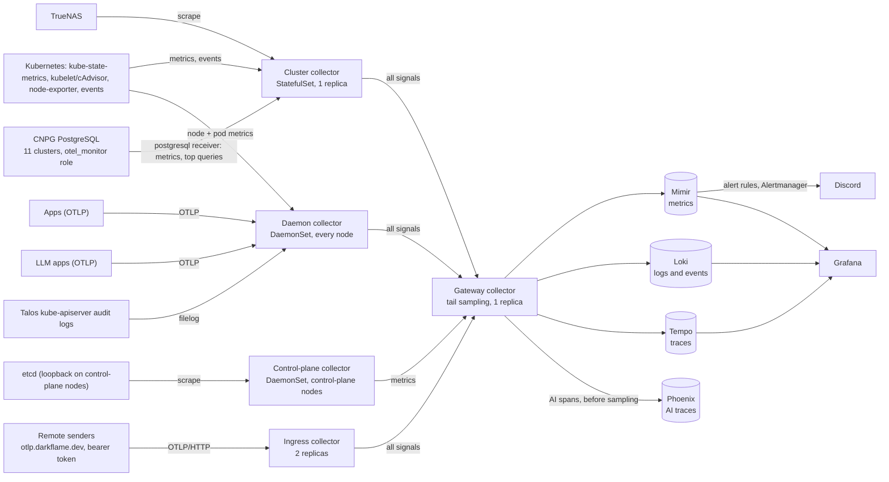

# Observability

Telemetry is collected by the [OpenTelemetry Operator](https://opentelemetry.io/docs/kubernetes/operator/)
(installed via `opentelemetry-kube-stack`) and stored in four backends. Grafana queries all of them.

Every collector sends its signals to one gateway collector. Only the gateway talks to storage. That
keeps backend endpoints, retries, and the Phoenix token in one place, and it lets tail sampling see whole
traces.

## Collectors

| Collector     | Shape                       | Job                                                                 |
|---------------|-----------------------------|---------------------------------------------------------------------|
| Cluster       | StatefulSet, 1 replica      | Cluster-wide metrics and events, NAS scraping, CNPG PostgreSQL      |
| Daemon        | DaemonSet, every node       | Node and pod metrics, container logs, audit logs, OTLP intake       |
| Control-plane | DaemonSet, control nodes    | etcd metrics from loopback (host network)                           |
| Ingress       | Deployment, 2 replicas      | OTLP/HTTP from outside the cluster, behind a bearer token           |
| Gateway       | Deployment, 1 replica       | Tail sampling of traces, the only path to storage and Phoenix       |

Only the gateway holds the storage endpoints and the Phoenix admin token. Every other collector exports
to `opentelemetry-kube-stack-gateway-collector` on port 4317.

## PostgreSQL (CNPG)

The cluster collector's `postgresql` receivers read every CNPG cluster through its `-rw` (primary) service,
as the `otel_monitor` role. Every CNPG cluster creates that role through `spec.managed.roles` with
`pg_monitor` membership. The shared password is `pg-monitor-secret`, synced from Infisical
(`/cloudnative-pg/otel-monitor-password`) by `apps/database/cloudnative-pg/pg-monitor-cluster-external-secret.yaml`.

- **Metrics** (`postgresql.*`, `metrics/postgres` pipeline): all 11 clusters, every 30s. The `cnpg_cluster`
  label holds the cluster name, taken from the `server.address` resource attribute.
- **Top queries are not collected.** The receiver's `top_query` event runs EXPLAIN on each captured query,
  which needs grants that cannot be declared in Git: CONNECT on the `app` database and EXECUTE on some
  privileged functions. Its `max_explain_each_interval` setting does not turn EXPLAIN off. Per-query data
  would need a different source.
- **Traces**: the receiver does not emit traces. Query traces come from the applications' own OTLP
  instrumentation. Postgres has no tracing of its own.
- **Query samples** (`db.server.query_sample`) are not collected. They carry literal parameter values from
  `pg_stat_activity`, which can contain personal data.

## Storage Backends

- **Mimir** stores metrics and evaluates alert rules, which are sent to Discord.
- **Loki** stores logs, Kubernetes events, and Talos audit logs.
- **Tempo** stores traces. Only traces that matter are kept (see Sampling).
- **Phoenix** stores AI/LLM traces (OpenInference or OTel GenAI spans) for review. Retention is 14 days.

## Dashboards and Alerts

- **Grafana** is the front end for all backends. Dashboards are managed by `grafana-operator`, so they
  are defined as `GrafanaDashboard` resources in Git.
- Each app that exposes metrics ships a `PodMonitor`, `ServiceMonitor` or dashboard next to its values.
- **Collector self-telemetry** is scraped from port 8888 on every collector. The `OtelExporterSendFailing`
  and `OtelReceiverRefusing` alerts fire when a collector drops data. They do not cover samples that
  Mimir rejects with a partial success (out-of-order or duplicate timestamps). Those show up in Mimir's
  `cortex_discarded_samples_total`.
- **Observability targets** are watched by `ObservabilityTargetDown`, which fires when a Mimir, Loki,
  Tempo, or Kiali scrape target stays down for 5 minutes.
- **Watchdog** is an always-firing heartbeat. An external monitor should alert when it stops arriving.
  That external watcher is not yet configured, so the heartbeat currently has no consumer.
- **Gatus** probes services from the outside and reports health on the status page. It alerts to Discord.
- **Kromgo** publishes the cluster health badges shown in the repository README.
- **Blackbox exporter** does HTTP and TCP probes that are not covered by the apps.
- **Kiali** shows the service mesh topology.

## Sampling

Applications head-sample traces. The Envoy gateways send 100% of their traces to the daemon collector,
which forwards them to the gateway collector. The gateway then keeps errors, requests slower than 500 ms,
and a 10% random baseline of the rest, and drops the others.

AI/LLM spans bypass sampling. The gateway sends every span that carries OpenInference or GenAI attributes
to Phoenix before the tail sampler runs.

## Alert Routing

Mimir Alertmanager routes alerts to Discord. Mimir's fallback configuration also sends to Discord, so
alerts still arrive if the main Alertmanager configuration fails to load.

## Querying

- Metrics: PromQL in Grafana Explore against Mimir.
- Logs: LogQL in Grafana Explore against Loki. Filter by namespace and app first.
- Traces: search in Tempo by service or trace ID.
- AI traces: the Phoenix UI, `phoenix.darkflame.dev`, via Authentik SSO.

## Troubleshooting Pointers

- No metrics for a new app: check that its `PodMonitor` or `ServiceMonitor` has a matching label.
- Missing traces: confirm the app exports OTLP to the daemon collector on port 4317.
- Telemetry gaps across all signals: check the gateway collector first. It is a single replica and every
  signal passes through it. Look at `OtelExporterSendFailing` and `OtelReceiverRefusing`, and at the
  gateway's memory against its 2 GiB limit.
- Missing AI spans in Phoenix: confirm the span carries an OpenInference or GenAI attribute. The
  `filter/ai` processor drops everything else.
