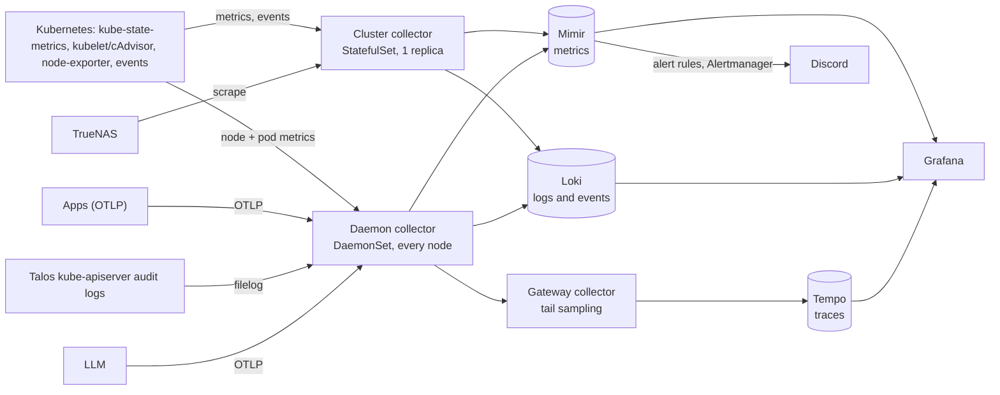

# Observability

Telemetry is collected by the [OpenTelemetry Operator](https://opentelemetry.io/docs/kubernetes/operator/)
(installed via `opentelemetry-kube-stack`) and stored in three backends. Grafana queries all of them.

## Collectors

| Collector  | Shape                  | Job                                             |
|------------|------------------------|-------------------------------------------------|
| Cluster    | StatefulSet, 1 replica | Cluster-wide metrics and events, NAS scraping   |
| Daemon     | DaemonSet, every node  | Node and pod metrics, container logs, OTLP intake |
| Gateway    | Deployment             | Tail sampling of traces before storage         |

## Storage Backends

- **Mimir** stores metrics and evaluates alert rules, which are sent to Discord.
- **Loki** stores logs, Kubernetes events, and Talos audit logs.
- **Tempo** stores traces. Only traces that matter are kept (see Sampling).

## Dashboards and Alerts

- **Grafana** is the front end for all backends. Dashboards are managed by `grafana-operator`, so they
  are defined as `GrafanaDashboard` resources in Git.
- Each app that exposes metrics ships a `PodMonitor`, `ServiceMonitor` or dashboard next to its values.
- **Gatus** probes services from the outside and reports health on the status page. It alerts to Discord.
- **Kromgo** publishes the cluster health badges shown in the repository README.
- **Blackbox exporter** does HTTP and TCP probes that are not covered by the apps.
- **Kiali** shows the service mesh topology.

## Sampling

Applications head-sample traces. The Envoy gateways send 100% of their traces to the daemon collector.
The gateway collector then keeps errors and requests slower than 500 ms and drops the rest.

## Alert Routing

Mimir Alertmanager routes alerts to Discord. Mimir's fallback configuration also sends to Discord, so
alerts still arrive if the main Alertmanager configuration fails to load.

## Querying

- Metrics: PromQL in Grafana Explore against Mimir.
- Logs: LogQL in Grafana Explore against Loki. Filter by namespace and app first.
- Traces: search in Tempo by service or trace ID.

## Troubleshooting Pointers

- No metrics for a new app: check that its `PodMonitor` or `ServiceMonitor` has a matching label.
- Missing traces: confirm the app exports OTLP to the daemon collector on port 4317.
