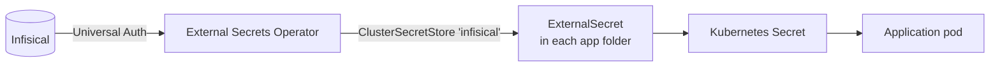

# Secrets Management

Secrets never go into Git in plain text. There are two mechanisms:

- **Infisical + External Secrets Operator** for application secrets inside the cluster.
- **SOPS + age** for files that must live in the repository, such as the Talos machine secrets.

## Infisical and External Secrets

[Infisical](https://infisical.com) is the source of truth for application secrets. The
[External Secrets Operator](https://external-secrets.io) copies them into Kubernetes `Secret` objects.

- A single `ClusterSecretStore` named `infisical` is shared by all namespaces. It authenticates with
  Universal Auth.
- Each app defines an `ExternalSecret` (usually `external-secret.yaml` in `apps/<namespace>/<app>/`)
  that maps Infisical keys to fields in the target secret. Paths look like
  `/<app>/<key-name>`.
- Templates can combine several values into one secret, such as an S3 configuration with an endpoint
  and region.

### The Only Manual Secret

The Universal Auth credentials that let External Secrets reach Infisical are the only secret applied
by hand. See the [Setup Guide](setup.md) for how to create them. Everything else is synced.

### Adding a Secret

1. Add the value in Infisical under the app's path.
2. Add or update the `ExternalSecret` in the app folder to map it.
3. Reference the generated Kubernetes secret from the app's values.

Commit only the `ExternalSecret`. Never commit the value.

### Writing to Infisical

The External Secrets identity is read-only. Changes to Infisical need a personal CLI login (`infisical`
in the `shell.nix` environment).

## SOPS and age

Some files are committed encrypted with [SOPS](https://github.com/getsops/sops) using an
[age](https://age-encryption.org) key:

- `talos/talsecret.sops.yaml` holds the Talos cluster secrets.
- `.sops.yaml` defines which keys can decrypt which files.

The age private key is referenced through the `SOPS_AGE_KEY_FILE` variable set by the Nix shell. It is
git-ignored. Keep an offline copy: losing it means losing the ability to decrypt the Talos secrets.

## Rules of Thumb

- Never commit plaintext secrets, kubeconfigs or talosconfigs. These are gitignored.
- Rotate a secret in Infisical, then let External Secrets refresh the Kubernetes secret. Restart the
  consuming workload if it reads secrets only at startup (the Reloader add-on can do this
  automatically).
- Use the narrowest access possible. Each app should only see its own secrets.
