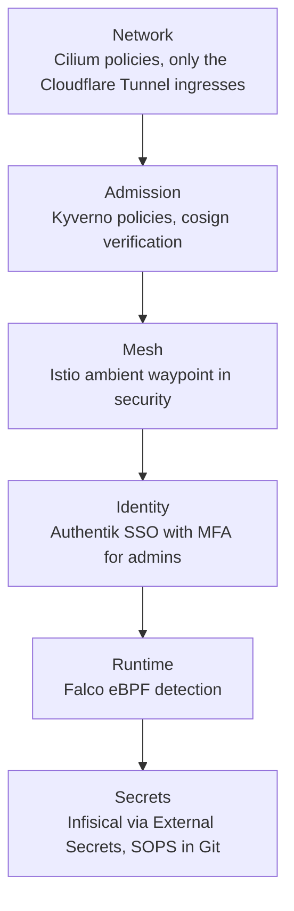

# Security

Security is layered: the node OS, the network, admission policy, identity, runtime detection, and
secret handling.

Each layer is a separate control, so a failure in one does not expose everything else.

## Node OS

- Talos Linux has no SSH, no shell and no package manager. Nodes are managed only through the Talos
  API, with `talosctl` and the configs described in [Hardware](hardware.md).
- Upgrades are automated and wait for node health (see [Cluster Overview](cluster.md#upgrades)).

## Network Isolation

- Cilium network policies restrict traffic between namespaces and applications.
- Public traffic only enters through the Cloudflare Tunnel to `envoy-external`. The router exposes no
  inbound ports.
- See [Networking](networking.md) for the full path.

## Admission Policy: Kyverno

[Kyverno](https://kyverno.io) validates and mutates resources at admission. Policies live in
`apps/policy/kyverno/policies/`:

| Policy                                | Effect                                             |
|---------------------------------------|----------------------------------------------------|
| `disallow-latest-tag`                 | Images must use a pinned tag, not `latest`         |
| `disallow-privileged-containers`      | Blocks privileged containers                       |
| `require-run-as-nonroot`              | Containers must run as a non-root user             |
| `require-requests-limits`             | Containers must declare resource requests and limits |
| `require-image-registry-allowlist`    | Images may only come from approved registries      |
| `verify-image-signatures`             | Images must carry a valid cosign signature         |
| `istio-*`                             | Ambient mesh namespace labels and waypoint setup   |

Exceptions for infrastructure namespaces are kept in `infra-exceptions.yaml`. Violations are shown in
[Policy Reporter](https://github.com/kyverno/policy-reporter).

Be careful with new policies. A Kyverno policy that blocks all pod creation can stop the whole cluster
from recovering, so test changes on one namespace first.

## Identity and SSO: Authentik

[Authentik](https://goauthentik.io) is the identity provider for applications that support OIDC or
forward auth. Its configuration is managed as blueprints in Git (`apps/security/authentik/blueprints/`).

- Administrators require MFA.
- Passkeys (WebAuthn) are supported. Cloudflare rules must not interfere with the WebAuthn endpoints.
- Blueprints are reconciled on an hourly discovery schedule, so a change can take up to an hour to
  apply.

## Service Mesh: Istio Ambient

Istio runs in ambient mode, with the control plane in `istio-system` (istiod, ztunnel and istio-cni).
The `security` namespace uses a namespace-wide waypoint proxy that adds L7 policy and mTLS-protected
traffic between services there. Mesh-wide telemetry is set in istiod.

## Runtime Detection: Falco

[Falco](https://falco.org) watches syscalls with the modern eBPF driver. The driver is used because
Talos has no kernel headers, so no kernel module can be built.

- Kubernetes audit events are collected separately (`falco-k8saudit`) and go through Fluent Bit.
- Alerts are forwarded through Falcosidekick.
- Known-noisy behavior from CI runners and CNPG backups is silenced in the rules. Each silence should be
  narrow.

## Upgrade Integrity

Talos and Kubernetes upgrades are rolled out one node at a time by tuppr. A node that fails its health
check stops the rollout.

## Secrets

Application secrets come from Infisical and never sit in Git. See [Secrets](secrets.md).

## Monitoring Security

- Gatus checks endpoints from outside the cluster and alerts to Discord.
- Audit and Falco events are searchable in Loki (see [Observability](observability.md)).
