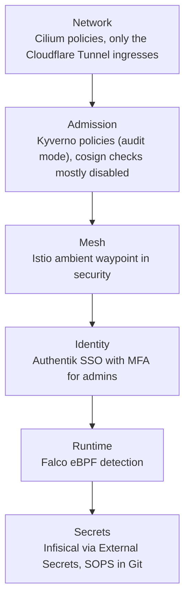

# Security

Security is layered: the node OS, the network, admission policy, identity, runtime detection, and
secret handling.

Each layer is a separate control, so a failure in one does not expose everything else.

## Node OS

- Talos Linux has no SSH, no shell and no package manager. Nodes are managed only through the Talos
  API, with `talosctl` and the configs described in [Hardware](hardware.md).
- Upgrades are automated and wait for node health (see [Cluster Overview](cluster.md#upgrades)).

## Network Isolation

- Cilium network policies restrict traffic between namespaces and applications.
- Public traffic only enters through the Cloudflare Tunnel to `envoy-external`. The router exposes no
  inbound ports.
- See [Networking](networking.md) for the full path.

## Admission Policy: Kyverno

[Kyverno](https://kyverno.io) (v1.20) runs in **audit mode**. Its validating and image-verification policies
record violations but do not reject resources, so nothing is blocked at admission today. Results are
shown in [Policy Reporter](https://github.com/kyverno/policy-reporter). The admission controller runs two
replicas behind a PodDisruptionBudget, because its `Fail` webhook on Pods blocks pod creation when it is down.

Most image-signature policies are **disabled**. They were turned off on Kyverno v1.18.2, which reported false
fails for images they don't match. One is re-enabled as a canary (`verify-image-signatures-argocd`) to test
whether v1.20 fixes that. Check its policy reports before enabling the others.

The policies use Kyverno's CEL-based types (`policies.kyverno.io`) and are defined in
`apps/policy/kyverno/policies/`. The live cluster has:

| Type                    | Count | What it does                                                             | Mode  |
|-------------------------|-------|--------------------------------------------------------------------------|-------|
| `ValidatingPolicy`      | 5     | Pinned image tags, no privileged containers, run as non-root, resource requests and limits, registry allowlist | Audit |
| `ImageValidatingPolicy` | 22    | Cosign signature checks, one per workload; 21 disabled, 1 canary (see above) | Audit |
| `MutatingPolicy`       | 3     | Istio ambient namespace labels, OpenTelemetry collector exclusion, waypoint resources | n/a |
| `GeneratingPolicy`      | 23    | Default Istio authorization policies per namespace, Grafana dashboards   | n/a   |
| `PolicyException`       | 24    | Exemptions for infrastructure workloads, all in the `policy` namespace   | n/a   |

Policy Reporter filters out Pods, ReplicaSets and Jobs, so a violation is reported once, against the
resource that owns it.

### Moving a policy to enforce

Switching a policy to enforcement changes what the cluster rejects, so do it in this order:

1. Check Policy Reporter for every current violation of that policy.
2. Fix the workloads, or add a `PolicyException` for the ones that must stay as they are.
3. Change `validationActions` from `Audit` to `Deny` in the policy file, then commit.

Test on one namespace first. A past policy change blocked all pod creation during a rollout and slowed
recovery, so don't enforce a policy cluster-wide in one step.

## Identity and SSO: Authentik

[Authentik](https://goauthentik.io) is the identity provider for applications that support OIDC or
forward auth. Its configuration is managed as blueprints in Git (`apps/security/authentik/blueprints/`).

- Administrators require MFA.
- Passkeys (WebAuthn) are supported. Cloudflare rules must not interfere with the WebAuthn endpoints.
- Blueprints are reconciled on an hourly discovery schedule, so a change can take up to an hour to
  apply.

## Service Mesh: Istio Ambient

Istio runs in ambient mode, with the control plane in `istio-system` (istiod, ztunnel and istio-cni).
The `security` namespace uses a namespace-wide waypoint proxy that adds L7 policy and mTLS-protected
traffic between services there. Mesh-wide telemetry is set in istiod.

## Runtime Detection: Falco

[Falco](https://falco.org) watches syscalls with the modern eBPF driver. The driver is used because
Talos has no kernel headers, so no kernel module can be built.

- Kubernetes audit events are collected separately (`falco-k8saudit`) and go through Fluent Bit.
- Alerts are forwarded through Falcosidekick.
- Known-noisy behavior from CI runners and CNPG backups is silenced in the rules. Each silence should be
  narrow.

## Upgrade Integrity

Talos and Kubernetes upgrades are rolled out one node at a time by tuppr. A node that fails its health
check stops the rollout.

## Secrets

Application secrets come from Infisical and never sit in Git. See [Secrets](secrets.md).

## Monitoring Security

- Gatus checks endpoints from outside the cluster and alerts to Discord.
- Audit and Falco events are searchable in Loki (see [Observability](observability.md)).
