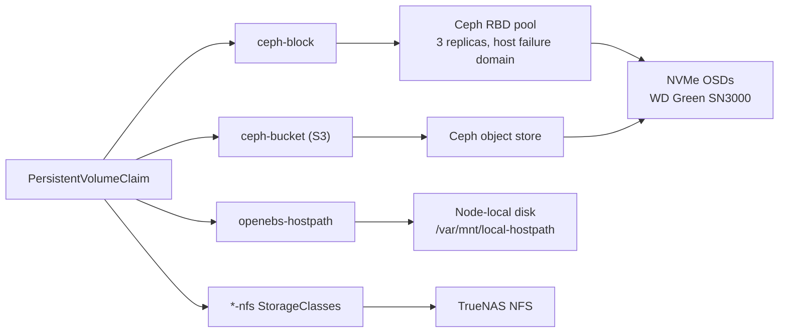

# Storage

The cluster has two storage tiers and a shared NFS option for workloads that need it.

| Class / source            | Backed by             | Replication       | Used for                          |
|---------------------------|-----------------------|-------------------|-----------------------------------|
| `ceph-block`              | Rook-Ceph RBD         | 3 replicas, per host | Most application data         |
| `ceph-bucket`             | Rook-Ceph object store (S3) | 3 replicas, per host | Object storage for apps   |
| `openebs-hostpath`        | OpenEBS LocalPV       | None (node-local) | Database volumes                  |
| `*-nfs` (one per share)   | NFS (NAS)             | Managed on the NAS | Large media and file data        |

## Rook-Ceph

[Rook](https://rook.io) runs a Ceph cluster on the worker nodes. The operator, cluster, and CSI drivers
are separate Helm releases.

- **Block pool** `ceph-blockpool` is replicated 3 times with a host failure domain. Its StorageClass is
  `ceph-block`, and it has a matching VolumeSnapshotClass.
- **Object store** `ceph-objectstore` is replicated the same way and provides S3 buckets through the
  `ceph-bucket` StorageClass.
- **CephFS** is not enabled. Nothing currently needs a shared filesystem, so the CephFS, NFS and NVMe-oF
  CSI drivers are all disabled.
- **OSDs** use only NVMe drives that match `WD_Green SN3000 1TB`, selected by device path. Other disks
  are never touched.
- **Dashboard** is available on the internal gateway at `rook.darkflame.dev`.
- **Monitoring** is enabled. Prometheus rules and a Grafana dashboard ship with the cluster chart.

### Known Ceph Health Warnings

`skipUpgradeChecks` is set on the Ceph cluster. This is deliberate: an open upstream manager-module crash
keeps Ceph from reaching `HEALTH_OK`, and the flag stops that from blocking future Rook upgrades. Check
the warnings with `kubectl rook-ceph ceph status` before assuming something new is broken.

## OpenEBS

OpenEBS runs only its LocalPV hostpath engine. Volumes are created under `/var/mnt/local-hostpath` on the
node that schedules the pod. Other OpenEBS engines (Mayastor, Jiva, cStor) are disabled.

Local volumes are not replicated. Losing a node loses the volumes on it, which is why databases use CNPG
replicas and Barman backups (see [Databases](databases.md) and [Backups](backups.md)).

## NFS

NFS-backed StorageClasses (named `*-nfs`, one per share) mount shares from the NAS. Use them only for
data that is large and already protected on the NAS.

## Choosing a Class

- Replicated and survives a node loss: `ceph-block`.
- Database data: `openebs-hostpath`, with database-level replication and backups.
- Large media shared with an app: NFS.
- S3-compatible object storage: `ceph-bucket`.

## Operating Notes

- Check Ceph health before draining or rebooting a node. Ceph's replicas need the other nodes to stay up.
- Node drains are sequenced by tuppr during Talos upgrades. See [Cluster Overview](cluster.md#upgrades).
